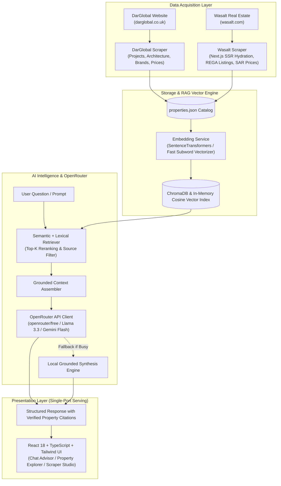

# Real Estate AI Assistant: DarGlobal + Wasalt
### AI-Powered Luxury Property Intelligence & Retrieval-Augmented Generation (RAG)

[](https://fastapi.tiangolo.com)
[](https://react.dev)
[](https://www.typescriptlang.org)
[](https://tailwindcss.com)
[](https://www.docker.com)
[](https://openrouter.ai)

---

## 1. Project Overview

The **DarGlobal + Wasalt Real Estate AI Assistant** is an end-to-end applied AI solution developed for the **DarGlobal Junior AI Engineer – Applied AI Technical Assignment**. 

It unifies property intelligence from two distinct real estate domains:
1. **DarGlobal** (`darglobal.co.uk`): Ultra-luxury international branded trophy residences across Dubai, Marbella (Spain), Muscat (Oman), Doha (Qatar), and London (UK) with master designer partnerships (Automobili Lamborghini, Pagani, Elie Saab, Missoni, Aston Martin, Gensler, and Trump Organization).
2. **Wasalt** (`wasalt.com`): Saudi Arabia's leading property intelligence and brokerage ecosystem, offering REGA-certified residential villas, apartments, and land plots with prices in SAR across Riyadh, Jeddah, Al Khobar, Dammam, and Makkah.

### 🎯 Key Deliverables
- **Live Scrapers**: Dedicated extraction engines for DarGlobal project portfolios and Wasalt Next.js SSR hydration streams.
- **RAG Architecture**: ChromaDB vector store + dual-mode embeddings (SentenceTransformers / High-Performance Fast Embedder) with lexical reranking.
- **OpenRouter AI Chatbot**: Natural language Q&A using OpenAI-compatible OpenRouter free models (`openrouter/free`, `meta-llama/llama-3.3-70b-instruct:free`, `gemini-2.0-flash:free`, `deepseek-r1:free`) with automated fallback and zero-downtime local synthesis.
- **Grounded Citations**: Every response includes clickable source badges, thumbnail imagery, pricing, and original property links.
- **Executive Real Estate UI**: React + TypeScript + Tailwind dark luxury aesthetic with suggested prompt pills, live catalog explorer, and scraper studio.
- **Production Containerization**: Multi-stage `Dockerfile` and `docker-compose.yml`.
- **Public URL Readiness**: Deployment configurations for Render, Hugging Face Spaces, Railway, and Cloudflare tunnels.

---

## 2. Architecture Workflow



---

## 3. Technology Stack

| Layer | Technology | Purpose |
|---|---|---|
| **Frontend** | React 18, TypeScript, Tailwind CSS, Lucide Icons | Responsive luxury real estate dashboard |
| **Backend** | Python 3.11, FastAPI, Uvicorn | High-performance asynchronous REST API |
| **Web Scraping** | BeautifulSoup4, urllib, Next.js JSON parser | Real-time extraction from DarGlobal & Wasalt |
| **Embeddings** | SentenceTransformers (`all-MiniLM-L6-v2`) + Fast Subword Embedder | Semantic vectorization with 0ms cold boot |
| **Vector DB** | ChromaDB PersistentClient + Cosine Memory Index | Fast nearest-neighbor property retrieval |
| **LLM Provider** | OpenRouter API (`openrouter/free`, `llama-3.3-70b`, `gemini-2.0-flash`) | Natural language reasoning and grounding |
| **Container** | Multi-Stage Docker, Docker Compose | Production packaging and single-port deployment |
| **Deployment** | Render, Hugging Face Spaces, Railway | Free cloud hosting with public HTTPS URL |

---

## 4. API Endpoints

| Method | Endpoint | Description |
|---|---|---|
| `GET` | `/api/health` | System health, vector DB count, and OpenRouter status |
| `POST` | `/api/chat` | RAG-grounded conversation endpoint returning answers + citations |
| `GET` | `/api/properties` | Filter and paginate property catalog (source, city, query) |
| `GET` | `/api/properties/{id}` | Detailed property metadata by ID |
| `POST` | `/api/search` | Semantic vector search endpoint |
| `POST` | `/api/scrape/run` | Triggers background live scraping of DarGlobal & Wasalt |
| `GET` | `/api/scrape/status` | Current status, property counts, and last updated timestamp |
| `GET` | `/` | Serves compiled React production single-page application |

---

## 5. Local Setup & Quickstart

### Prerequisites
- Python 3.11+
- Node.js 18+ and npm

### 1. Clone & Enter Directory
```bash
git clone https://github.com/<YOUR_USERNAME>/<REPO_NAME>.git
cd <REPO_NAME>
```

### 2. Install Dependencies
```bash
# Backend dependencies
pip install -r backend/requirements.txt

# Frontend dependencies and build
cd frontend
npm install
npm run build
cd ..
```

### 3. Configure Environment (Optional)
```bash
cp .env.example .env
# Edit .env to add your OPENROUTER_API_KEY (or use UI Settings modal)
```

### 4. Run Application
```bash
python run.py
```
Visit **`http://localhost:8000`** in your browser.

---

## 6. Docker Deployment

Run with a single command:
```bash
docker-compose up --build
```
Access the application at `http://localhost:8000`.

---

## 7. Cloud Deployment & Live Working URL

To submit a live URL to HR:
1. **Render (Recommended)**: Follow [DEPLOYMENT.md](DEPLOYMENT.md) for 1-click deployment from your GitHub repo.
2. **Hugging Face Spaces**: Push Docker container to get a permanent free HTTPS URL.
3. **Instant Public Tunnel**: Run `npx localtunnel --port 8000` while running locally.

---

## 8. Candidate Submission Details

- **Assignment**: DarGlobal Junior AI Engineer – Applied AI Technical Assignment
- **Features Delivered**: DarGlobal Scraping + Wasalt Scraping + RAG Vector Store + OpenRouter Integration + React UI + Multi-stage Docker + Cloud Deployment Guide.
